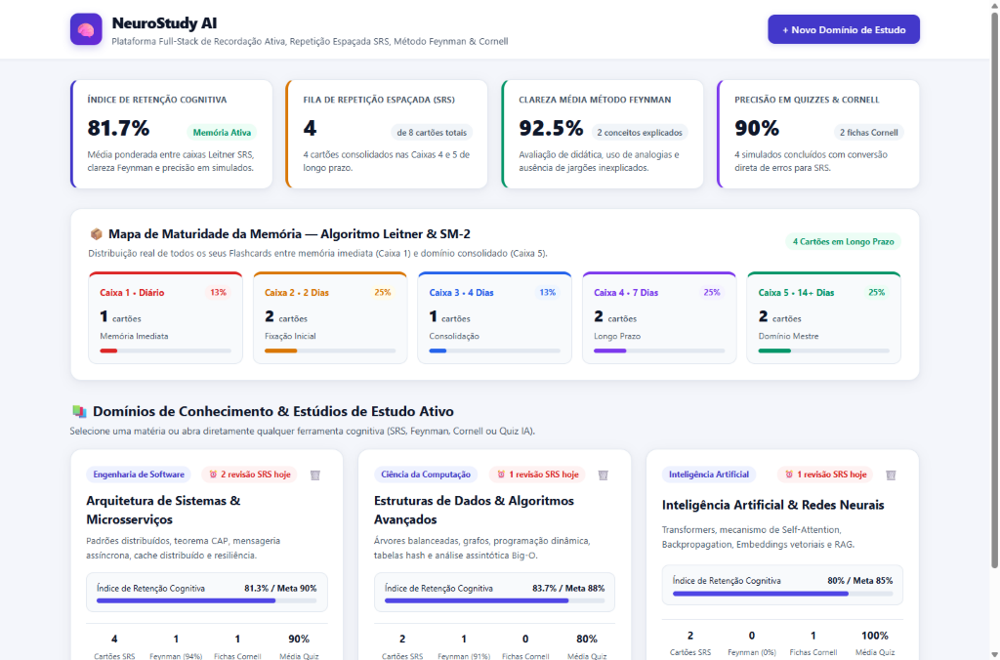
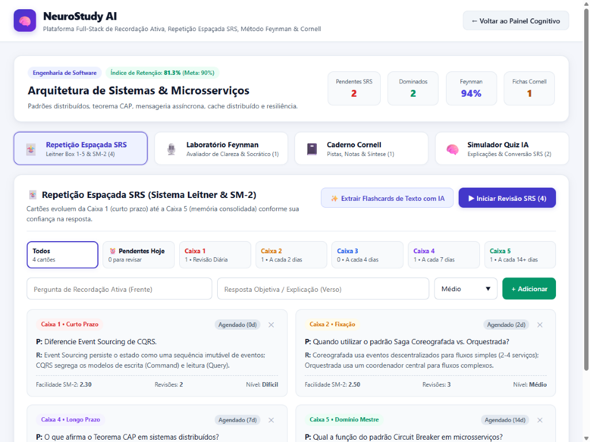
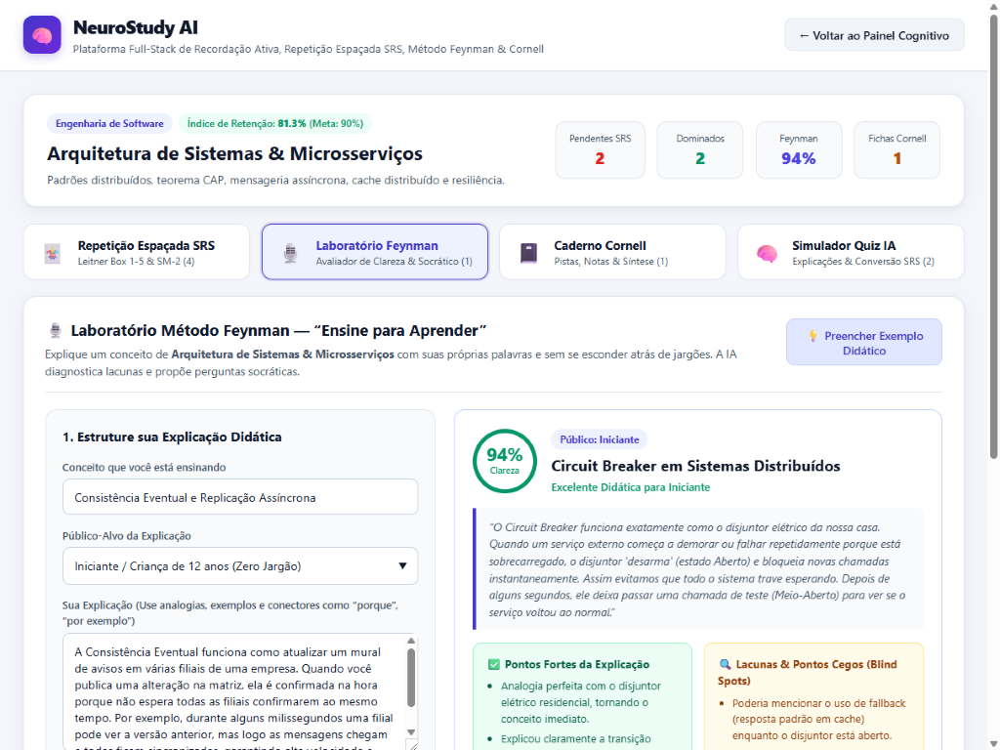
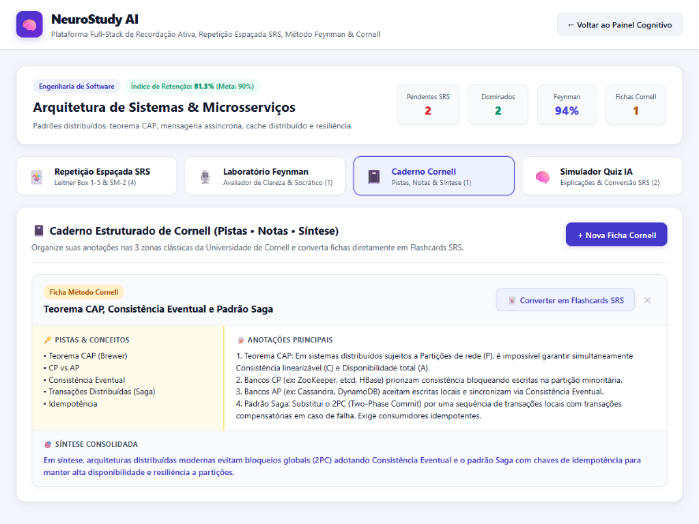
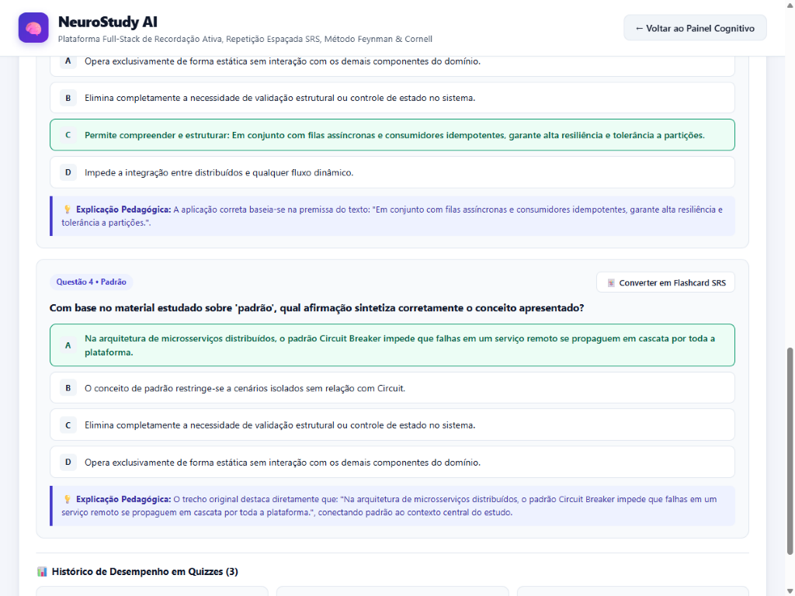

# 🧠 NeuroStudy AI — Plataforma Full-Stack de Aprendizagem Cognitiva & Recordação Ativa

Plataforma Full-Stack (**FastAPI + SQLAlchemy + React + TypeScript + IA Cognitiva**) projetada para retenção de conhecimento de longo prazo por meio de **Repetição Espaçada (SRS Leitner & Algoritmo SM-2)**, **Laboratório Método Feynman ("Ensine para Aprender")**, **Caderno Estruturado de Cornell** e **Simulador de Quiz Ativo com IA**.

---

## 📸 Preview da Plataforma

### 1. Painel de Retenção Cognitiva & Pirâmide de Memória Leitner (Caixas 1 a 5)
Visão executiva do **Índice Global de Retenção Cognitiva (%)**, fila diária de cartões pendentes de revisão SRS, clareza média no Método Feynman, precisão em simulados e distribuição de maturidade da memória entre as **Caixas 1 a 5 de Leitner**.



### 2. Repetição Espaçada SRS (Sistema Leitner & Algoritmo SM-2)
Gestão inteligente de flashcards com agendamento automático de revisões (`Caixa 1 • Diário` até `Caixa 5 • Domínio Mestre 14+ dias`), cálculo dinâmico de **Fator de Facilidade SM-2** e **Extrator Automático de Flashcards a partir de Textos com IA**.



### 3. Laboratório Método Feynman — “Ensine para Aprender”
Ambiente onde o estudante explica um conceito com suas próprias palavras para um público-alvo definido (*Iniciante / Zero Jargão*, *Colega de Graduação* ou *Entrevista Técnica*) e recebe diagnóstico instantâneo com **Score de Clareza (0–100%)**, **Pontos Fortes**, **Lacunas & Pontos Cegos (Blind Spots)**, **Perguntas Socráticas** e **Analogia Mental Recomendada**.



### 4. Caderno Estruturado de Cornell (Pistas • Notas • Síntese)
Sistema clássico da Universidade de Cornell dividido em três zonas cognitivas (**Coluna de Pistas & Conceitos**, **Anotações Principais** e **Síntese Consolidada**) com conversão em **1 clique para Flashcards SRS**.



### 5. Simulador de Quiz Ativo com IA & Conversão de Erros para SRS
Geração de simulados contextualizados por nível de profundidade (*Iniciante*, *Intermediário*, *Avançado*) com **Explicação Pedagógica** detalhada em cada alternativa, histórico de precisão e botão para converter questões diretamente em cartões de repetição espaçada.



---

## ✨ Diferenciais & Funcionalidades Principais

- **📦 Repetição Espaçada Híbrida (Leitner Box 1–5 + SM-2):**
  - Avaliação ativa em 4 níveis de esforço cognitivo (`1. Errei / Reset Caixa 1`, `2. Difícil / 1d`, `3. Bom / +1 Caixa`, `4. Fácil / +2 Caixas`).
  - Ajuste dinâmico do `ease_factor` (Fator de Facilidade SM-2) e cálculo automático de `next_review_at`.
  - **Extrator IA Texto → Flashcards:** transforma qualquer resumo ou artigo em cartões SRS prontos para revisão.
- **🎙️ Laboratório Método Feynman & Questionamento Socrático:**
  - Avalia explicações escritas pelo estudante identificando uso de analogias, conectores causais e ausência de jargões inexplicados.
  - Gera **Perguntas Socráticas** personalizadas para estimular reflexão profunda e constrói um portfólio de conceitos validados por matéria.
- **📓 Caderno Estruturado de Cornell com Conversão Automática:**
  - Registro estruturado em **Pistas (30%)**, **Notas Detalhadas (70%)** e **Síntese Final**.
  - Endpoint dedicado (`POST /cornell/{note_id}/to-flashcards`) que extrai automaticamente flashcards SRS a partir da ficha Cornell.
- **🧠 Motor Cognitivo Híbrido (Google Gemini + Fallback NLP Determinístico):**
  - Integração nativa com **Google Gemini (`gemini-2.5-flash`)** quando `GEMINI_API_KEY` está configurada, acompanhada de um motor **NLP Cognitivo Determinístico** integrado que garante funcionamento 100% offline e em ambientes de teste sem necessidade obrigatória de chave externa.

---

## 🏗️ Arquitetura & Tecnologias

| Camada | Tecnologias |
| :--- | :--- |
| **Backend API** | Python 3.12, FastAPI, SQLAlchemy 2.0, Pydantic v2, Uvicorn, Google Generative AI |
| **Banco de Dados** | SQLite (`study_assistant.db`) com migração automática de schema e seed cognitivo inicial |
| **Frontend Web** | React 19, TypeScript, Vite 7, Axios, CSS Editorial Responsivo |
| **Testes Automatizados** | Pytest + FastAPI `TestClient` cobrindo ciclo SRS SM-2, Método Feynman, Cornell, Quiz IA e Analytics |

---

## 🔌 Principais Endpoints da API REST

- `GET /analytics/overview` — Métricas globais de retenção cognitiva e distribuição das Caixas 1–5 de Leitner.
- `GET /subjects/` & `POST /subjects/` — Listagem e criação de domínios de estudo com categoria e meta de retenção.
- `GET /subjects/{id}/flashcards` & `POST /flashcards/` — Gestão do deck SRS da matéria.
- `POST /flashcards/{card_id}/review` — Algoritmo SRS Leitner/SM-2 (`again`, `hard`, `good`, `easy`).
- `POST /ai/extract_flashcards` — Extração automática de flashcards SRS a partir de textos de estudo.
- `POST /ai/feynman_evaluate` & `GET /subjects/{id}/feynman` — Avaliação de clareza pelo Método Feynman e histórico.
- `POST /cornell/`, `GET /subjects/{id}/cornell` & `POST /cornell/{note_id}/to-flashcards` — Fichas do Método Cornell e conversão direta em flashcards.
- `POST /ai/generate_quiz` & `POST /quizzes/attempts` — Geração de simulados ativos com explicação pedagógica e registro de acurácia.

---

## 🚀 Como Executar Localmente

### 1. Backend (FastAPI)

```bash
cd backend
pip install -r requirements.txt

# (Opcional) Configurar chave do Google Gemini:
# export GEMINI_API_KEY="sua-chave-aqui"

uvicorn app.main:app --reload --port 8000
```

Para executar a suíte de testes automatizados do backend:

```bash
cd backend
pytest -v
```

### 2. Frontend (React + Vite)

```bash
cd frontend
npm install
npm run dev
```

Acesse a aplicação em `http://localhost:5173` (a documentação interativa Swagger da API fica disponível em `http://localhost:8000/docs`).
